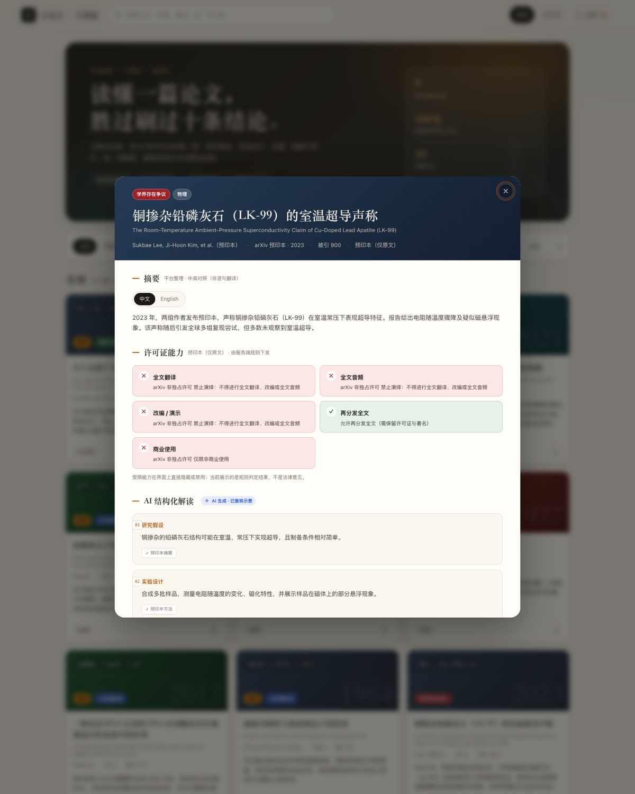
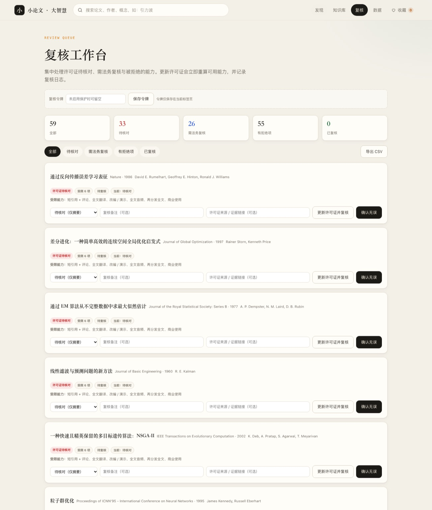
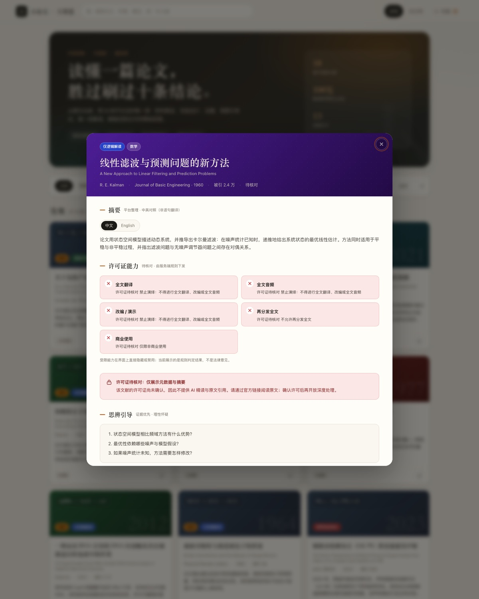
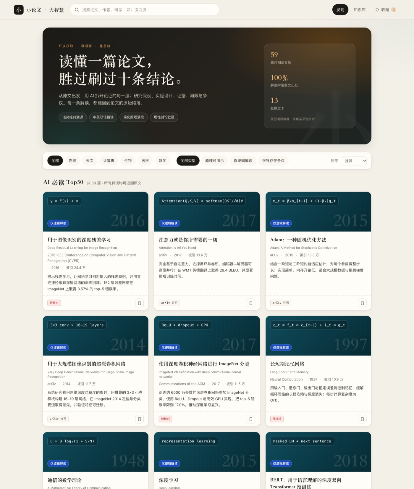

# 小论文 · 大智慧

一款**可溯源的科学知识库 × 学术科普信息流**应用。以开放获取（OA）论文为唯一内容根基，用 AI 把论文拆解成"假设—证据—结论—局限—争议"，让研究生、本科生、科技爱好者和普通大众都能读懂一手研究，而不只是记住二手结论。

> 一句话：**不只告诉你科学家发现了什么，还给你看他们是怎么证明的。**


## 为什么做

- **信息失真**：大众获取科学信息高度依赖媒体转述，多层传播后容易断章取义、夸大其词。
- **门槛过高**：外文术语、实验设计、统计方法构成阅读壁垒，科研新手长期停留在"读摘要、背结论"。
- **链路断裂**：学术数据库只有原文，短视频科普省略论证，AI 科研工具又只服务专业用户——没有产品把"原文 → 解读 → 演示 → 讨论"串起来。

## 产品形态

很多类似产品只做"信息流"或只做"论文库"。本项目的差异是把两者合成一个结构：

| 层 | 作用 | 形态 |
| --- | --- | --- |
| **知识库层** | 沉淀可检索的结构化知识 | 论文卡片、概念卡、主题合集、引用与争议关系 |
| **解读层** | 把论文变成可理解的内容 | 双语精读、论证脉络、简化演示、局限提示 |
| **信息流层** | 让知识被发现、被讨论 | 卡片信息流、个性化推荐、单篇讨论区 |
| **思辨层** | 让用户学会质疑而非接受 | 变量控制、适用范围、替代解释等引导问题 |

**核心栏目**：诺贝尔奖经典论文全维度溯源——从 1905 年光电效应到 mRNA 疫苗，还原里程碑发现的思考与实验过程。

## 核心能力（规划）

1. **AI 文献处理**：外文朗读、双语对照、自动抽取研究假设 / 实验方案 / 核心结论 / 研究局限 / 学界争议，关键内容人工复核。
2. **科普演示**：区分【原理可演示】【仅逻辑解读】【学界争议】三类标签，能用简化实验演示的拍短视频，不能的用流程图与仿真动画讲逻辑。
3. **知识库**：概念卡片（p 值、对照组、相关≠因果、预注册……）与论文互相链接，形成可回溯的概念—证据网络。
4. **社区与思辨**：卡片信息流 + 单篇讨论区 + 引导式思辨问题，禁止随意定性造假，撤稿文献自动下架并标注风险。


## 仓库内容

```
.
├── README.md                    # 项目总览（本文件）
├── xiaolunwen.txt               # 原始设计方案（论文体，已补全）
├── docs/
│   ├── 01-product-design.md     # 产品方案：用户、竞品、功能优先级、商业模式
│   ├── 02-technical-architecture.md  # 技术架构：数据模型、AI 流水线、合规
│   ├── 03-roadmap.md            # 里程碑、MVP 范围、指标体系
│   ├── 04-license-policy.md     # 许可证策略、操作模型与决策矩阵
│   └── assets/                  # README 预览图
├── content/
│   ├── license-manifest.json    # 示例文献的许可证清单
│   └── local/                   # 本地 PDF 导入候选（gitignore，不入库）
├── tools/
│   ├── license-check/           # 可执行的许可证校验器 + 测试
│   ├── pdf-import/              # 本地 PDF 元数据/摘要提取工具
│   └── corpus-import/           # 本地 AI Top50 语料构建工具
├── server/                      # M1 后端：SQLite 入库 + JSON API + 测试
│   ├── README.md
│   ├── db.mjs
│   ├── ingest.mjs
│   ├── server.mjs
│   └── api.test.mjs
└── prototype/                   # 可运行的前端原型（纯静态，Mock 数据）
    ├── README.md
    ├── index.html
    ├── css/style.css
    └── js/{data.js,app.js}
```

## 快速开始

原型零依赖，不需要安装任何东西：

```bash
cd prototype
python3 -m http.server 8080
# 浏览器打开 http://localhost:8080
```

也可以直接双击 `prototype/index.html` 打开。

许可证校验器同样是零依赖的 Node 脚本：

```bash
node tools/license-check/check.mjs content/license-manifest.json
node --test tools/license-check/check.test.mjs
```

M1 后端同为零依赖（Node 22+ 内置 SQLite）：

```bash
node server/ingest.mjs      # 按许可证裁剪字段后写入 SQLite
node server/server.mjs      # API + 原型，http://127.0.0.1:8787
PORT=8123 node server/server.mjs   # 也可指定端口
node --test server/api.test.mjs
```

**原型包含**：信息流卡片、学科/标签筛选、搜索、论文详情（双语摘要、AI 拆解、演示说明、讨论区、思辨问题）、知识库概念卡片、收藏（localStorage）。

> ⚠️ 原型仅用于交互与视觉验证，论文元数据与解读内容均为演示用 Mock 数据，上线前必须逐篇核对原文与许可协议。

## M1 后端（进行中）

`server/` 提供最小可跑的数据层与 API，用来验证"许可证进入代码"这条链路：

- **入库**：`server/ingest.mjs` 读取同一份原型数据，用许可证校验器计算每篇论文允许的操作；被拒绝的能力（商业使用、改编等）不会写入可展示字段，并记录到 `ingest_log`。
- **API**：`server/server.mjs` 暴露 `/api/papers`、`/api/papers/:id`、`/api/concepts`、`/api/topics`、讨论读写与 `/api/license/:code`。
- **能力下发**：每条内容返回 `license.allowed`，前端据此隐藏翻译、音频、商业入口，并在详情页展示"许可证能力"面板。
- **前端接入**：由 `server/` 托管时，原型优先从 `/api/bootstrap` 取数并读写讨论；直接打开静态文件或 API 不可用时自动回退到本地示例数据。
- **存储**：Node 22 内置 SQLite（实验特性），正式环境按技术方案切换 PostgreSQL。



```bash
curl http://127.0.0.1:8787/api/papers/einstein-1905
curl "http://127.0.0.1:8787/api/license/CC-BY-NC-4.0?action=translate_fulltext"
```

当前示例结果：18 篇演示论文；合并本地 Top50 后共 59 篇、185 项许可证检查、56 项拒绝、4 项需法务复核。详见 [server/README.md](server/README.md)。

### 复核工作台（M2 前置）

API 模式下导航会出现「复核」入口，集中处理许可证待核对、需法务复核与被拒绝的能力：

- 队列按状态筛选：全部 / 待核对 / 需法务复核 / 有拒绝项 / 已复核。
- 可直接选择新许可证并保存，服务端会**立即重算** `license.allowed`，写入 `review_log` 与复核备注。
- 也可仅标记“确认无误”，不改变许可证。
- 当前为本地原型，复核接口没有鉴权，不能直接暴露到公网。



## 本地 PDF 导入

`tools/pdf-import/` 可以把本地下载的 PDF 转成候选元数据清单，再人工核对 DOI 与许可证后入库：

```bash
python3 tools/pdf-import/extract.py ~/Downloads/Papers \
  --out content/local/import-candidates.json
```

本次已将 `~/Downloads/Papers` 中的 9 篇经典论文接入「经典算法论文」专题（Kalman、NSGA-II、差分进化、反向传播、EM、模拟退火、PSO、SMOTE、SVM）。这些文献的许可证均未确认，因此统一标记为 `UNVERIFIED`：只展示元数据、平台自写摘要与思辨问题，不开放 AI 解读、翻译或商业使用。548 页的《Reinforcement Learning: An Introduction》作为教材未按论文入库。



> PDF 原文、全文翻译与候选摘要片段都不进入仓库；`content/local/` 已被 `.gitignore` 忽略。

### 本地 AI Top50 语料

`tools/corpus-import/` 可以把 AI Top50 结构化清单转成同样的本地语料：

```bash
node tools/corpus-import/build-top50.mjs \
  --dataset ~/goldstock-releases/ai-papers-top50-2026-11-16/ai-papers-top50-2026-11-16.json

node server/ingest.mjs
PORT=8123 node server/server.mjs
```

生成 `content/local/top50.json` 后，入库会自动合并：**演示语料 18 篇 + 本地新增 41 篇 = 59 篇**，并新增「AI 必读 Top50」专题。9 篇重叠论文复用已有条目，不重复导入。期刊名与开放许可优先采用 OpenAlex；arXiv 论文标记 `ARXIV-NONEXCLUSIVE`，其余未确认许可的统一标记 `UNVERIFIED`。

其中 ResNet、Transformer、Adam、BERT、ViT、GPT-3 六篇提供结构化论证拆解（研究假设 / 实验设计 / 核心结论 / 研究局限 / 学界争议），统一标注为「AI 辅助整理 · 待复核」；解读为平台原创概述，不是全文翻译。

> 本地语料不会提交；缺少 `content/local/top50.json` 时，入库仍只包含演示语料 18 篇。



## 路线图

| 阶段 | 范围 | 目标 |
| --- | --- | --- |
| M0（已完成） | 方案文档 + 交互原型 | 验证信息架构与阅读体验 |
| M1（进行中） | 数据层 + 许可证服务 + API；诺奖专题内容 | 跑通"溯源—解读—讨论"最小闭环 |
| M2 | 概念卡与检索、AI 抽取 + 人工复核工作台 | 知识库结构成型 |
| M3 | 推荐信息流、创作者投稿、会员体系 | 内容供给与商业化验证 |

详见 [docs/03-roadmap.md](docs/03-roadmap.md)。

## 合规与伦理底线

- **版权**：仅收录可公开传播的 OA 文献，并**按具体许可证**过滤——CC BY-NC 不做商业性使用，CC BY-ND 不做翻译等演绎；非 OA 文献只展示摘要、DOI 与官方链接。翻译权与演绎权单独校验。
- **学术定位**：平台只做科普解读，不承担学术仲裁与"打假"职能，所有 AI 内容标注来源与复核状态。
- **AI 标识**：AI 生成的解读、翻译、演示脚本按《人工智能生成合成内容标识办法》加显式与隐式标识。
- **内容安全**：UGC 社区接入审核与举报机制，撤稿、更正、学术不端文献同步下架并提示。
- **简化失真**：演示内容明确标注"科普简化，非科研级复现"，不用于判定论文真伪。

## 文档

- [产品设计方案（docs/01-product-design.md）](docs/01-product-design.md)
- [技术架构（docs/02-technical-architecture.md）](docs/02-technical-architecture.md)
- [路线图（docs/03-roadmap.md）](docs/03-roadmap.md)
- [许可证策略与校验器（docs/04-license-policy.md）](docs/04-license-policy.md)
- [原始设计方案（xiaolunwen.txt）](xiaolunwen.txt)

## 许可证

[MIT](LICENSE) © 2026 OldJohn86
