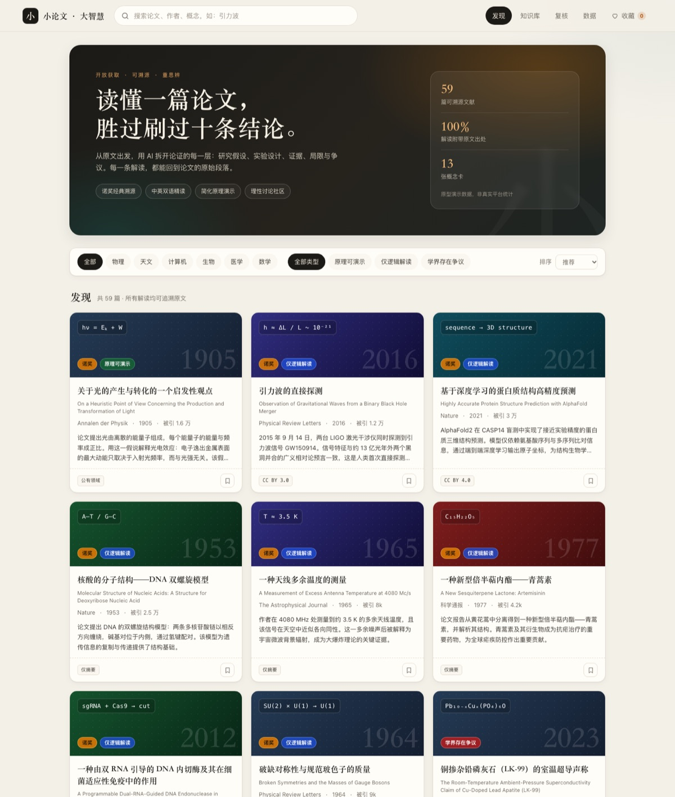
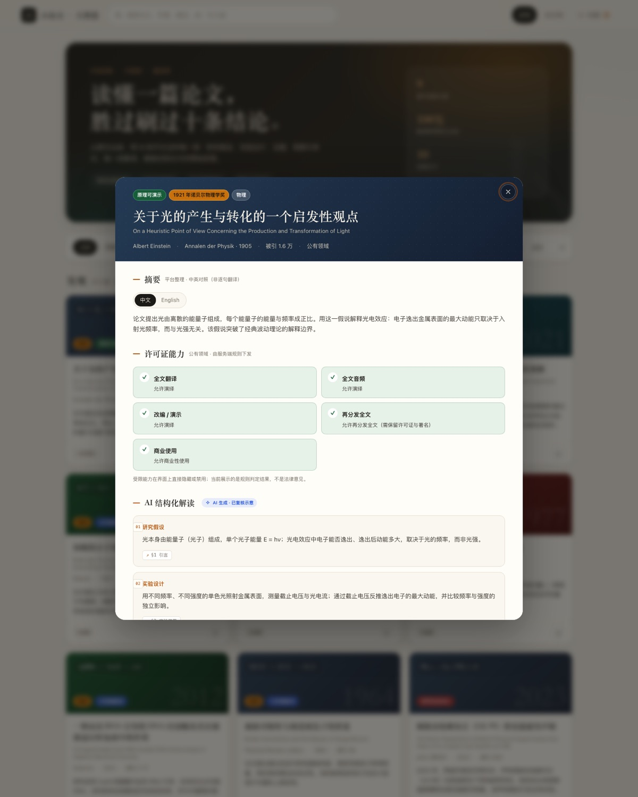

# 小论文 · 大智慧

一款**可溯源的科学知识库 × 学术科普信息流**应用。以开放获取（OA）论文为唯一内容根基，用 AI 把论文拆解成"假设—证据—结论—局限—争议"，让研究生、本科生、科技爱好者和普通大众都能读懂一手研究，而不只是记住二手结论。

> 一句话：**不只告诉你科学家发现了什么，还给你看他们是怎么证明的。**



## 为什么做

- **信息失真**：大众获取科学信息高度依赖媒体转述，多层传播后容易断章取义、夸大其词。
- **门槛过高**：外文术语、实验设计、统计方法构成阅读壁垒，科研新手长期停留在"读摘要、背结论"。
- **链路断裂**：学术数据库只有原文，短视频科普省略论证，AI 科研工具又只服务专业用户——没有产品把"原文 → 解读 → 演示 → 讨论"串起来。

## 产品形态

很多类似产品只做"信息流"或只做"论文库"。本项目的差异是把两者合成一个结构：

| 层 | 作用 | 形态 |
| --- | --- | --- |
| **知识库层** | 沉淀可检索的结构化知识 | 论文卡片、概念卡、主题合集、引用与争议关系 |
| **解读层** | 把论文变成可理解的内容 | 双语精读、论证脉络、简化演示、局限提示 |
| **信息流层** | 让知识被发现、被讨论 | 卡片信息流、个性化推荐、单篇讨论区 |
| **思辨层** | 让用户学会质疑而非接受 | 变量控制、适用范围、替代解释等引导问题 |

**核心栏目**：诺贝尔奖经典论文全维度溯源——从 1905 年光电效应到 mRNA 疫苗，还原里程碑发现的思考与实验过程。

## 核心能力（规划）

1. **AI 文献处理**：外文朗读、双语对照、自动抽取研究假设 / 实验方案 / 核心结论 / 研究局限 / 学界争议，关键内容人工复核。
2. **科普演示**：区分【原理可演示】【仅逻辑解读】【学界争议】三类标签，能用简化实验演示的拍短视频，不能的用流程图与仿真动画讲逻辑。
3. **知识库**：概念卡片（p 值、对照组、相关≠因果、预注册……）与论文互相链接，形成可回溯的概念—证据网络。
4. **社区与思辨**：卡片信息流 + 单篇讨论区 + 引导式思辨问题，禁止随意定性造假，撤稿文献自动下架并标注风险。



## 仓库内容

```
.
├── README.md                    # 项目总览（本文件）
├── xiaolunwen.txt               # 原始设计方案（论文体，已补全）
├── docs/
│   ├── 01-product-design.md     # 产品方案：用户、竞品、功能优先级、商业模式
│   ├── 02-technical-architecture.md  # 技术架构：数据模型、AI 流水线、合规
│   ├── 03-roadmap.md            # 里程碑、MVP 范围、指标体系
│   ├── 04-license-policy.md     # 许可证策略、操作模型与决策矩阵
│   └── assets/                  # README 预览图
├── content/
│   └── license-manifest.json    # 示例文献的许可证清单
├── tools/
│   └── license-check/           # 可执行的许可证校验器 + 测试
└── prototype/                   # 可运行的前端原型（纯静态，Mock 数据）
    ├── README.md
    ├── index.html
    ├── css/style.css
    └── js/{data.js,app.js}
```

## 快速开始

原型零依赖，不需要安装任何东西：

```bash
cd prototype
python3 -m http.server 8080
# 浏览器打开 http://localhost:8080
```

也可以直接双击 `prototype/index.html` 打开。

许可证校验器同样是零依赖的 Node 脚本：

```bash
node tools/license-check/check.mjs content/license-manifest.json
node --test tools/license-check/check.test.mjs
```

**原型包含**：信息流卡片、学科/标签筛选、搜索、论文详情（双语摘要、AI 拆解、演示说明、讨论区、思辨问题）、知识库概念卡片、收藏（localStorage）。

> ⚠️ 原型仅用于交互与视觉验证，论文元数据与解读内容均为演示用 Mock 数据，上线前必须逐篇核对原文与许可协议。

## 路线图

| 阶段 | 范围 | 目标 |
| --- | --- | --- |
| M0（当前） | 方案文档 + 交互原型 | 验证信息架构与阅读体验 |
| M1 | 诺奖专题 10 篇 + 双语精读 + 单篇讨论 | 跑通"溯源—解读—讨论"最小闭环 |
| M2 | 概念卡与检索、AI 抽取 + 人工复核工作台 | 知识库结构成型 |
| M3 | 推荐信息流、创作者投稿、会员体系 | 内容供给与商业化验证 |

详见 [docs/03-roadmap.md](docs/03-roadmap.md)。

## 合规与伦理底线

- **版权**：仅收录可公开传播的 OA 文献，并**按具体许可证**过滤——CC BY-NC 不做商业性使用，CC BY-ND 不做翻译等演绎；非 OA 文献只展示摘要、DOI 与官方链接。翻译权与演绎权单独校验。
- **学术定位**：平台只做科普解读，不承担学术仲裁与"打假"职能，所有 AI 内容标注来源与复核状态。
- **AI 标识**：AI 生成的解读、翻译、演示脚本按《人工智能生成合成内容标识办法》加显式与隐式标识。
- **内容安全**：UGC 社区接入审核与举报机制，撤稿、更正、学术不端文献同步下架并提示。
- **简化失真**：演示内容明确标注"科普简化，非科研级复现"，不用于判定论文真伪。

## 文档

- [产品设计方案（docs/01-product-design.md）](docs/01-product-design.md)
- [技术架构（docs/02-technical-architecture.md）](docs/02-technical-architecture.md)
- [路线图（docs/03-roadmap.md）](docs/03-roadmap.md)
- [许可证策略与校验器（docs/04-license-policy.md）](docs/04-license-policy.md)
- [原始设计方案（xiaolunwen.txt）](xiaolunwen.txt)

## 许可证

[MIT](LICENSE) © 2026 OldJohn86
