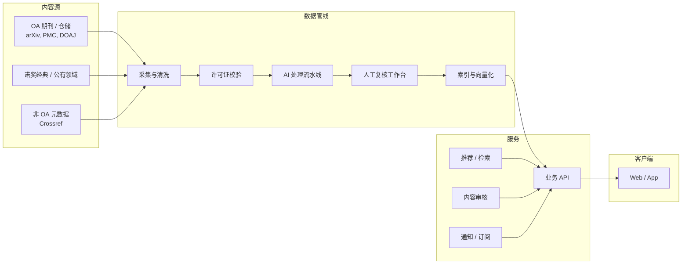
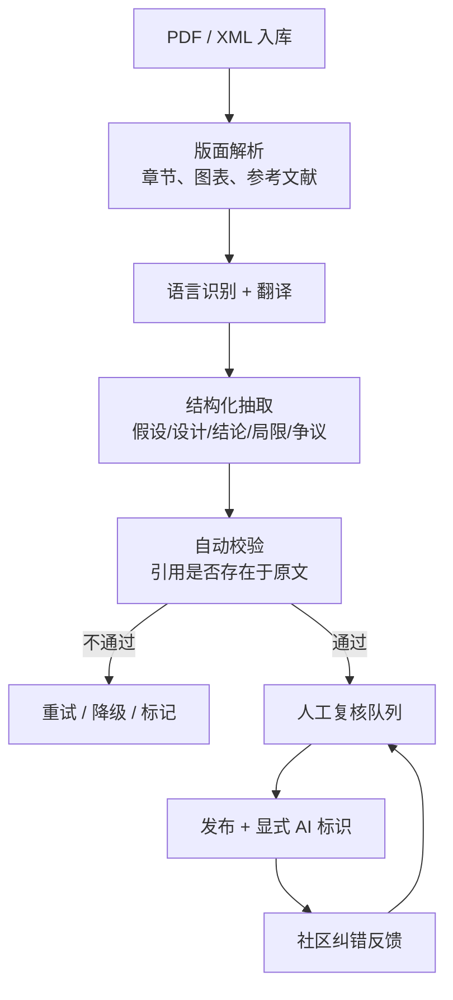

# 技术架构

> 版本：v0.2 ｜ 状态：设计稿 ｜ 当前仓库仅有静态原型，本篇为落地时的技术基线

## 1. 总体架构



**技术选型（建议）**

| 层 | 选型 | 理由 |
| --- | --- | --- |
| 前端 | Next.js + TypeScript + Tailwind | SSR 利于 SEO 与分享，生态成熟 |
| 后端 | Next.js Route Handlers 或 FastAPI | MVP 用 BFF 足够；AI 任务用 Python 服务 |
| 数据库 | PostgreSQL + pgvector | 元数据、关系、向量检索一套搞定 |
| 对象存储 | S3 / 阿里云 OSS | PDF、音频、视频、封面 |
| 任务队列 | Redis + Celery / BullMQ | AI 处理耗时长，必须异步 |
| 搜索 | PostgreSQL 全文检索 → 后期 Meilisearch | 起步避免额外运维 |
| 审核 | 第三方内容安全 API + 人工 | 国内合规必需 |
| 可观测性 | OpenTelemetry + Sentry | 追踪 AI 调用成本与失败率 |

> **实现状态**：M1 骨架以零依赖方式落地（`server/`，Node 内置 HTTP + SQLite），用于验证数据模型、许可证服务与 API 契约；正式环境仍按上表切换 Next.js 与 PostgreSQL。

## 2. 核心数据模型

```sql
-- 论文
papers(id, doi, title_en, title_zh, abstract_en, abstract_zh,
       journal, year, authors jsonb, citation_count,
       license_code, license_url, oa_status, source_url,
       pdf_url, topics text[], status, created_at)

-- 许可证白名单（关键）
licenses(code, name, allows_commercial, allows_derivatives,
         requires_attribution, requires_sharealike, notes)
-- CC BY: 可商用、可演绎；CC BY-NC: 不可商用；CC BY-ND: 不可演绎（含翻译）

-- AI 解读（每条结论必须可溯源）
interpretations(id, paper_id, kind,  -- hypothesis|design|result|limitation|controversy|translation
                content_md, source_refs jsonb,  -- [{section, page, quote}]
                model, prompt_version, review_status,  -- draft|ai_checked|human_verified|rejected
                reviewer_id, reviewed_at, ai_label)

-- 概念卡
concepts(id, slug, name_zh, name_en, definition_md, examples jsonb)

-- 论文—概念关系
paper_concepts(paper_id, concept_id, relation)  -- uses|tests|defines|criticizes

-- 内容标签
paper_tags(paper_id, tag)  -- demonstrable|logic_only|controversial|retracted|corrected

-- 讨论
posts(id, paper_id, user_id, parent_id, body_md, status, created_at)

-- 收藏 / 专题
collections(id, user_id, title, description, is_public)
collection_items(collection_id, paper_id, note)
```

**设计原则**

1. **AI 内容不覆盖原文**：解读与原文分开存，前端并排展示，避免混淆。
2. **段落级溯源**：每条解读的 `source_refs` 指向原文段落/页/引用片段，前端可高亮跳转。
3. **许可证是一等公民**：`licenses` 表决定内容能做什么（展示、翻译、商用、生成音频），代码中集中实现 `canUse(license, action)`。
4. **软删除 + 状态机**：撤稿、更正、下架只改状态，保留审计轨迹。

## 3. AI 处理流水线



**各环节要点**

- **解析**：优先使用 JATS XML / PMC 结构化全文；只有 PDF 时用版面模型，保留页码供溯源。
- **翻译**：段落级对齐；术语表锁定（如 control group → 对照组）；保留原文引用编号。
- **抽取**：输出 JSON Schema 约束的字段（假设、自变量、因变量、对照组、样本量、主要结论、局限、争议），禁止自由发挥；每个字段必须带 `source_refs`。
- **幻觉控制**：任何抽取出的数值 / 结论必须能在原文中检索到对应片段，否则丢弃；无法确认的标为"原文未明确"。
- **人工复核**：按风险分级——数值、结论、争议类强制复核；纯翻译抽查。复核状态展示给用户。
- **成本控制**：按热度分层（精选全流程 / 长尾轻量）；结果缓存；翻译与音频按需生成。

## 4. 检索与推荐

- **检索**：标题/作者/摘要的全文检索 + 概念同义词扩展；论文向量与概念向量做混合排序。
- **推荐**：先做规则（学科偏好、收藏、阅读完成度）+ 协同过滤；冷启动用诺奖专题与热门概念卡。
- **可解释**：推荐理由展示（"因为你收藏了 3 篇量子力学论文"），避免黑箱。

## 5. 合规设计

| 要求 | 实现 |
| --- | --- |
| 著作权 | 入库前许可证校验；NC 内容不对会员售卖路径开放；ND 内容不翻译/不改编；非 OA 只存元数据与链接 |
| AI 生成内容标识 | 在内容页、导出文件、音视频元数据中加入显式标识；API 响应带 `ai_generated` 字段 |
| UGC 审核 | 先审后发（讨论区）+ 关键词/模型审核 + 举报通道 + 违规处置记录 |
| 算法推荐备案 | 推荐逻辑与参数留档；提供"关闭个性化推荐"开关 |
| 未成年人保护 | 青少年模式；限制打赏/付费入口 |
| 数据与隐私 | 最小化收集；导出/删除账号；日志脱敏 |

## 6. 非功能需求

- **性能**：信息流 P95 < 300ms（缓存后）；详情页 P95 < 800ms；AI 任务异步，前端显示进度。
- **可用性**：核心读路径 99.9%；AI 失败可降级为"仅原文摘要"。
- **可追溯**：每条 AI 内容记录模型、提示词版本、来源片段、复核人，支持审计。
- **安全**：PDF 上传隔离解析；防 SSRF；对象存储私有 + 签名 URL；Prompt 注入防护（把论文全文视为不可信输入）。

## 7. 部署与成本估算（MVP）

- **部署**：Web + API 容器化部署；Postgres 托管；队列与对象存储按量。
- **成本大头**：AI 推理。按 10 万篇入库、1% 走全流程估算，需先用 100 篇做成本基准测试再定价。
- **建议**：上线前跑一轮"单篇成本"基准（解析 + 翻译 + 抽取 + 复核工时），以它反推会员价格与免费额度。
